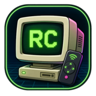
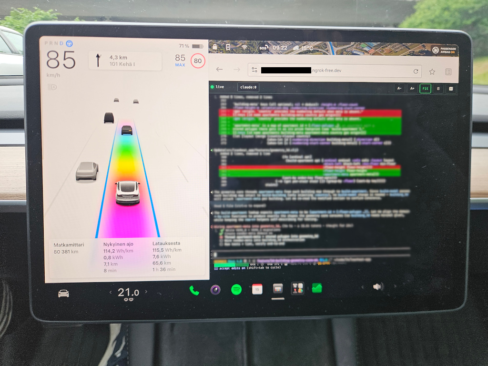
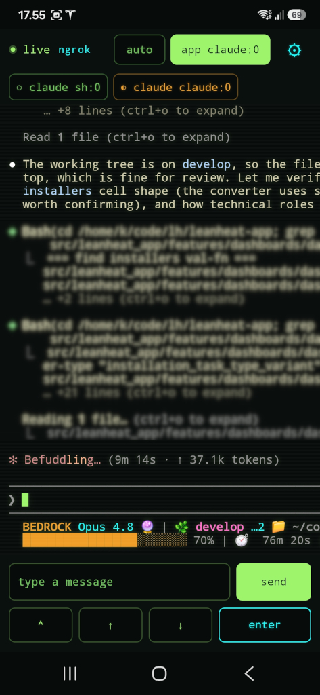

<p align="center">
  
</p>

<h1 align="center">Airc Tmux Remote</h1>

<p align="center">
  <em>Watch and steer your laptop's tmux sessions — and the AI coding agent running in it — from any phone, tablet, or car browser.</em>
</p>

<p align="center">
  <a href="#quick-start">Quick Start</a> ·
  <a href="#going-remote">Going Remote</a> ·
  <a href="#android-app-optional">Android App</a> ·
  <a href="INSTALLATION.md">Install</a> ·
  <a href="#more-docs">Docs</a>
</p>

---

You start an AI coding agent - Claude Code, Codex, Copilot, whatever - in a tmux
session and walk away. Airc lets you glance at what it's doing from the couch,
and tap a few keys to nudge it along, without unlocking the laptop.

It's a small Node server on your laptop that captures tmux panes, serves a live
browser viewer, and accepts input only from clients holding a token. It's not
tied to any one AI tool - if it runs in tmux, you can watch and drive it.

**The browser is all you need.** A phone, tablet, or even a car browser opens
the viewer over your LAN with zero accounts and zero install. The
[Android app](#android-app-optional) and [public tunnel](#going-remote) are
optional add-ons for when you want more.

<p align="center">
  
</p>

## Quick Start

You need **Node ≥ 20.19** and **tmux**. Nothing else.

```sh
git clone https://github.com/Kynde/airc.git
cd airc
npm install

tmux new -s main             # or attach to a session you already have

tools/airc local             # serve on your LAN
tools/airc pair-web-control  # prints a QR + URL - open it on your phone
```

Scan the QR (or open the printed URL) on any device on the same Wi-Fi, and the
live terminal is in your hand. Airc follows every live tmux session by default,
so the name above doesn't matter.

> **No tokens to configure.** On first run Airc generates strong `viewToken` and
> `controlToken` values into `config.json` for you. `pair-web-control` hands out
> the token that can type; [`pair-web`](#view-vs-control) hands out a view-only
> one, for when you'd rather share a read-only link.

`local` mode binds your LAN address and keeps everything on your own network —
no third-party services involved.

## Features

- **Live tmux mirror** — ANSI colors and cursor position, updated over WebSocket
  with HTTP-polling fallback.
- **Follow the active pane** automatically, or pin a specific pane.
- **Type from anywhere** — text input plus quick Up / Down / Enter / Esc / Tab /
  Ctrl-key buttons that target the viewed pane.
- **Attention alerts** — Airc notices which pane's agent is waiting on *you* and
  can auto-follow it. See [Attention](docs/attention.md).
- **Speak a prompt** — optional: a mic button that records on the laptop,
  transcribes it there, and types the text into the pane you're viewing, so a
  car browser can dictate a whole instruction. Needs
  [dais](https://github.com/Kynde/dais) and is off by default. See
  [Speaking a prompt](docs/dais.md).
- **Readable on small screens** — font fit/manual sizing, light/dark theme,
  pause.
- **Works in a car** — tested in a Tesla browser; the viewer stays live while
  driving. See [Tesla notes](docs/tesla-browser.md).

## Going Remote

`local` mode only reaches devices on the same Wi-Fi. To watch from anywhere —
mobile data, a friend's network, a car on the road — Airc can run behind a
public tunnel.

> **ngrok is currently unusable from the Tesla browser.** ngrok's free tier puts
> an interstitial warning page in front of any browser that hasn't clicked
> through it lately — the "Visit Site" click sets a cookie that only lasts 7
> days — and that page renders blank in the car, so Airc never loads. While it's
> showing, every path is affected, `/probe` included. The interstitial draws all
> of its content from `cdn.ngrok.com`, so nothing appears if that script doesn't
> run, and there's no button left to click. ngrok blocks the documented
> workarounds (`ngrok-skip-browser-warning`, custom `User-Agent`) on free
> accounts, including via Traffic Policy. Use an external tunnel instead, or a
> paid ngrok plan.

Tunnels live under `tunnels` in `config.json`, one entry each with its own
`enabled` flag. Point `tunnels.tailscale.url` (or `tunnels.external.url`) at any
tunnel you run yourself — [Tailscale
Funnel](INSTALLATION.md#public-access-with-an-external-tunnel), Cloudflare Tunnel,
a reverse proxy — and Airc advertises that address in bookmarks and the pairing
QR. Airc doesn't start or supervise those; it only needs the URL.

Airc can also run ngrok itself (`tunnels.ngrok`), which needs a (free) account
and a one-time setup. Several tunnels can be enabled at once — they all keep
working, and `tunnels.prefer` picks which one gets advertised. The full
walkthrough — plus how to serve LAN **and** tunnel at once so the app uses a
direct connection at home and the tunnel away — is in
**[INSTALLATION.md](INSTALLATION.md#public-access-with-an-external-tunnel)**.

```sh
tools/airc on                # start the server with the configured tunnel
tools/airc pair-web-control  # QR/URL now points at the public address
```

## Android App (optional)

Everything above works in the browser. The Android app is the same server seen
through a native client, and it adds two things the browser can't easily match:

- **Dictation and a real keyboard** — Android IME input, including voice.
- **Automatic failover** — one pairing payload carries both your LAN and public
  URLs, so the app uses the direct connection at home and the tunnel away.

Grab the signed APK from the [latest release](https://github.com/Kynde/airc/releases/latest)
(`airc-<version>.apk`) and sideload it, or build it yourself with the Android
SDK. See **[INSTALLATION.md](INSTALLATION.md#installing-the-android-app)**.

<p align="center">
  
</p>

## View vs. Control

Airc uses two tokens, so you can share a read-only link safely:

- **`viewToken`** — can *watch* the terminal, nothing else.
- **`controlToken`** — can watch **and** send keystrokes to tmux.

```sh
tools/airc pair-web           # QR/URL with the VIEW token (read-only)
tools/airc pair-web-control   # QR/URL with the CONTROL token (can type)
tools/airc pair-app           # Android pairing payload (control token)
```

The browser only shows the input controls when you open it with a control token.

## Common Commands

```sh
tools/airc local              # serve on the LAN (no tunnel, no accounts)
tools/airc on                 # serve behind the configured ngrok tunnel
tools/airc status             # process + health
tools/airc pair-web           # view-only browser QR/URL
tools/airc pair-web-control   # control browser QR/URL
tools/airc pair-app           # Android pairing QR/JSON
tools/airc off                # stop the server
tools/airc logs               # path to the server log
```

## More Docs

- [Installation](INSTALLATION.md): prerequisites, ngrok setup, building the app,
  zsh completions
- [Operations](docs/operations.md): running, pairing, sizing, troubleshooting
- [Docs index](docs/README.md): everything else, in recommended reading order

## Vibe / Author

The code here was largely written by AI agents. It was done in accordance to my specifications. This is a hobby project and a research into agentic workflows. The project itself evolved from a simple tmux viewer for my car into what it is now. I use it daily for work as well as extra curriculum activities.

I've been coding since I was 8 back in 1984, I have over 30 years of professional experience in programming countless langauges.

## License

[MIT](LICENSE).
